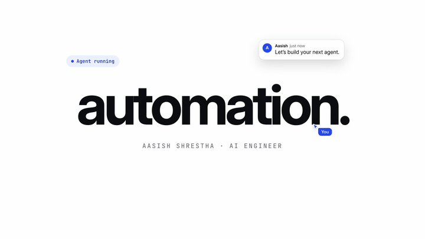
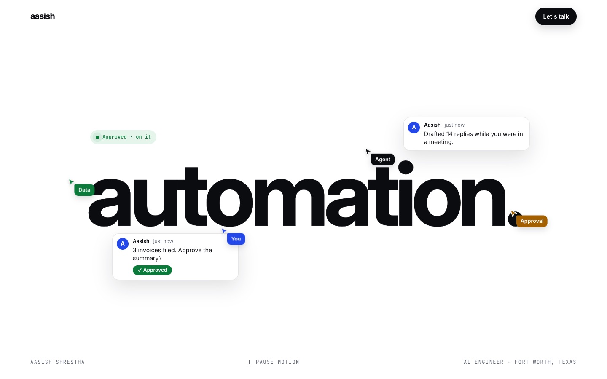
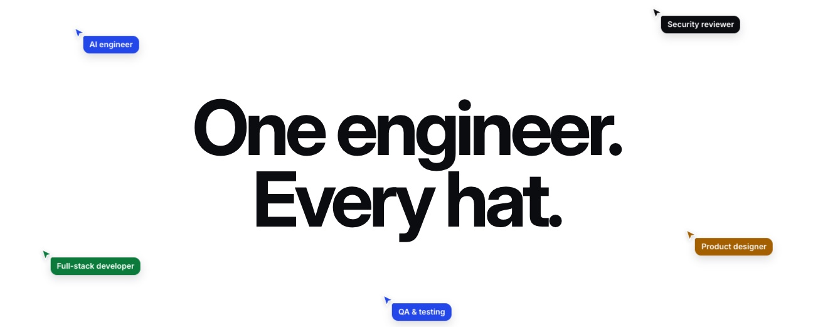
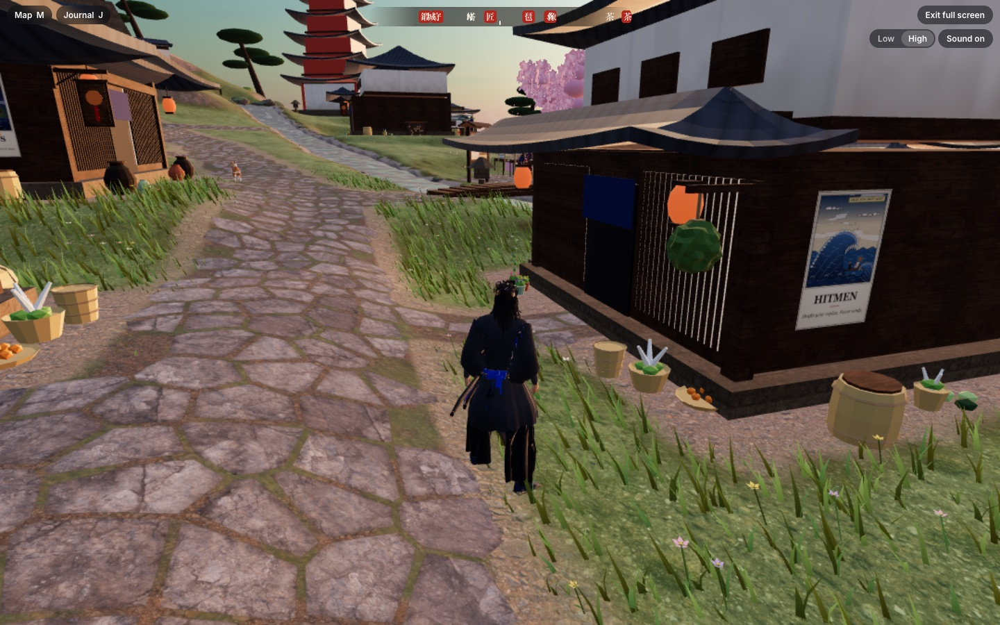
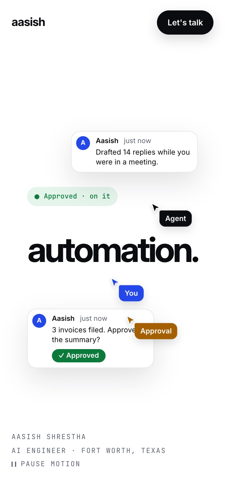

# Aasish Shrestha — Portfolio

Personal site of an AI engineer: AI agents, LLM-powered products and workflow automation, built secure.
It ends with **Aasish World**, a small 3D Edo-village island you can walk around, right in the contact section.

<p align="center">
  
</p>

## Demo

| Hero | What I build |
| --- | --- |
|  |  |

**Aasish World**, the playable village in the contact section:



<p align="center">
  
</p>

## What's inside

- **Site:** Next.js 15 (App Router), React, GSAP and Lenis for motion, with a "Pause motion" switch and reduced-motion support.
- **Game:** three.js and Rapier physics, fixed 60 Hz steps with smooth interpolation. Walk, talk to villagers, ride the boat, keep a journal. Progress is saved in the browser.
- **Film:** a 45-second film rendered from HTML (`video/`).
- **Now playing:** recent music from Last.fm (`/api/lastfm`).
- **Contact form:** sends through FormSubmit, with no backend to run.
- **Fast:** Lighthouse desktop 100 / 96 / 100 / 100, and the game holds 60 fps in Chromium, Safari (WebKit) and Firefox.

## Run it locally

```bash
npm install
npm run dev          # http://localhost:3200
```

Create `.env.local` for the optional features:

| Variable | What it does |
| --- | --- |
| `LASTFM_API_KEY`, `LASTFM_USER` | "Now playing" music |
| `NEXT_PUBLIC_SITE_URL` | Public address used in the sitemap and share previews |
| `NEXT_PUBLIC_FORM_ENDPOINT` | Optional FormSubmit alias for the contact form |

Production build and smoke test (page loads, game walks at 60 fps, no errors):

```bash
npm run build && npm start
npm run smoke
```

## Credits

The game uses only free-to-use assets: Nataraja (Cleveland Museum of Art, CC0), Poly Haven (CC0), Quaternius Universal Animation Library (CC0), MPFB / MakeHuman (CC0), Kokoro voices (Apache-2.0), Piper with the OHF-Voice chitwan dataset (CC0), CC0 sound effects, three.js and Rapier.
All characters are original.

## License

© Aasish Shrestha. All rights reserved. The code is here to read, not to reuse.
The third-party assets above keep their own licences.
